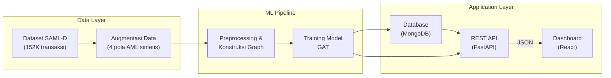
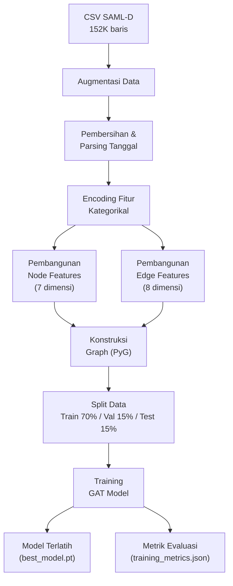
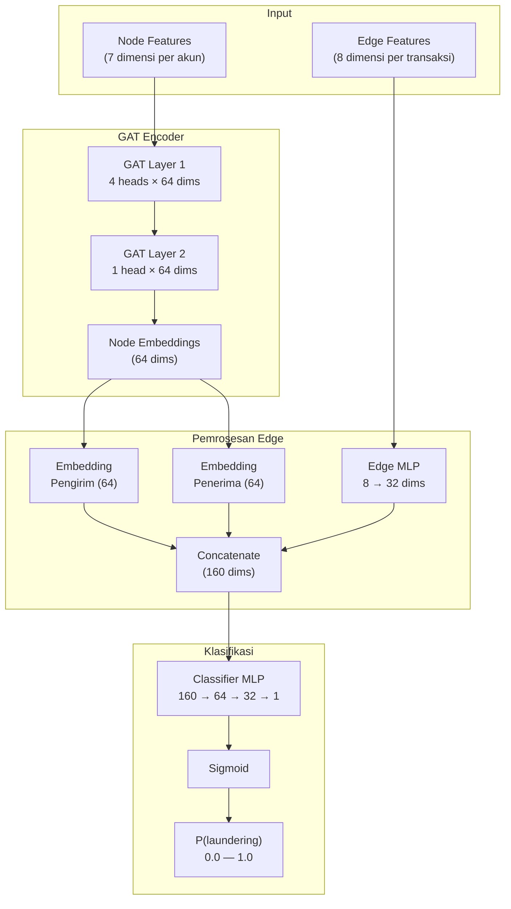
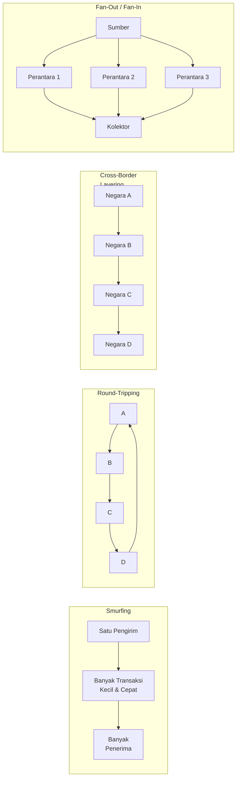
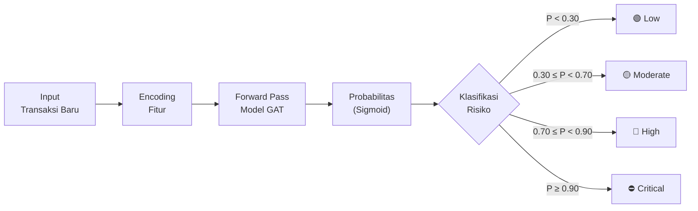
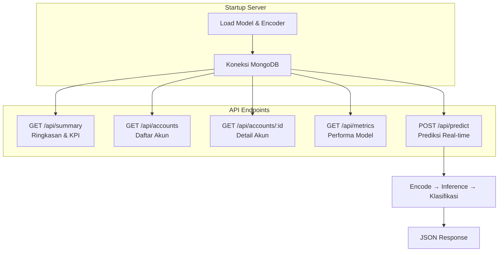
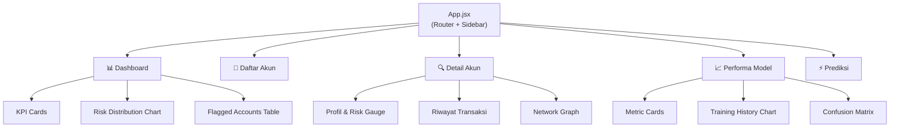
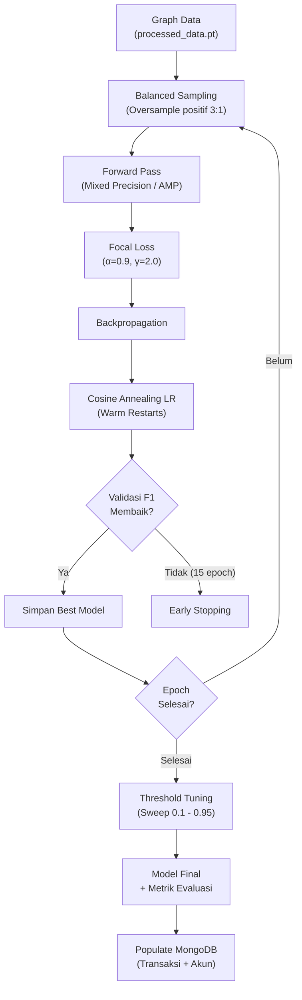
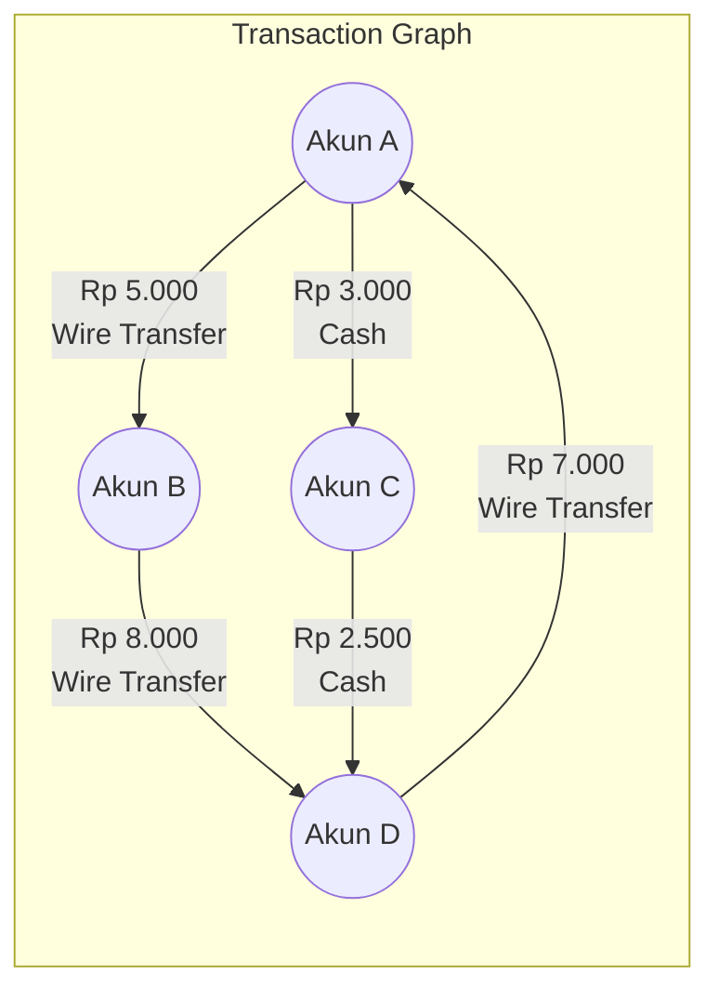
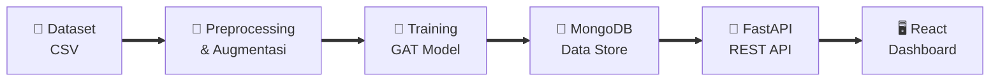

# 📊 AML Guard — Diagram untuk Skripsi

Dokumen ini berisi diagram-diagram yang disederhanakan untuk keperluan penulisan skripsi.

---

## 1. Arsitektur Sistem Keseluruhan

Gambaran umum arsitektur sistem AML Guard dari data hingga dashboard.

---

## 2. Alur Data Pipeline

Tahapan pemrosesan data dari CSV mentah hingga model terlatih.

---

## 3. Arsitektur Model GAT (EdgeGATModel)

Alur forward pass model Graph Attention Network untuk klasifikasi edge.

---

## 4. Pola Augmentasi Data (Money Laundering Patterns)

Empat pola pencucian uang sintetis yang diinjeksikan ke dataset.

---

## 5. Alur Prediksi Real-Time

Bagaimana sistem memproses transaksi baru untuk prediksi risiko.

---

## 6. Arsitektur Backend API

Struktur endpoint FastAPI dan alur pemrosesan request.

---

## 7. Arsitektur Frontend Dashboard

Struktur halaman dashboard React dan komponen utamanya.

---

## 8. Diagram Training Pipeline

Detail proses training model GAT dengan teknik optimasi.

---

## 9. Representasi Graph Transaksi

Bagaimana transaksi dimodelkan sebagai graph.

**Keterangan:**
- **Node** = Akun (dengan 7 fitur: total_sent, total_received, dll.)
- **Edge** = Transaksi (dengan 8 fitur: amount, currency, dll.)
- Setiap edge diklasifikasikan secara independen oleh model GAT

---

## 10. Alur End-to-End (Ringkasan)

---

  AML Guard — Anti-Money Laundering Detection System 
  Dokumen diagram untuk keperluan skripsi

